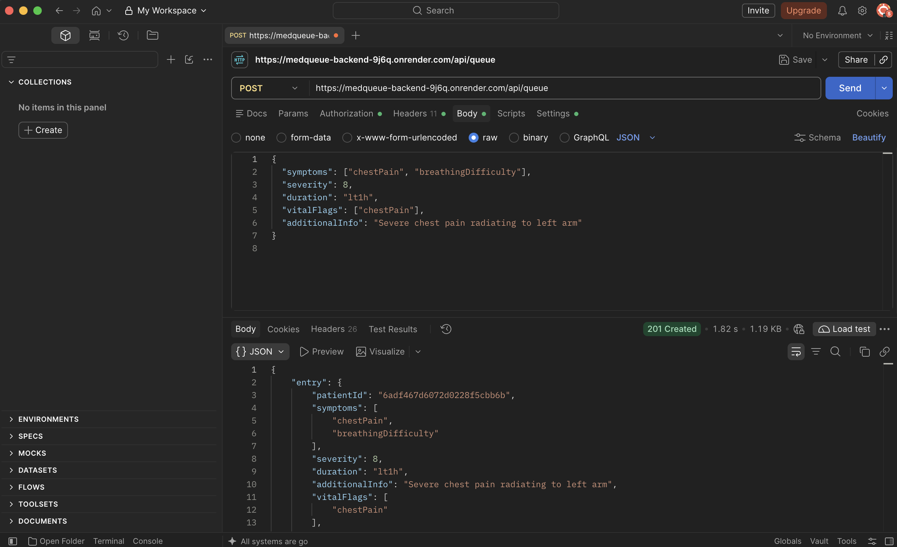
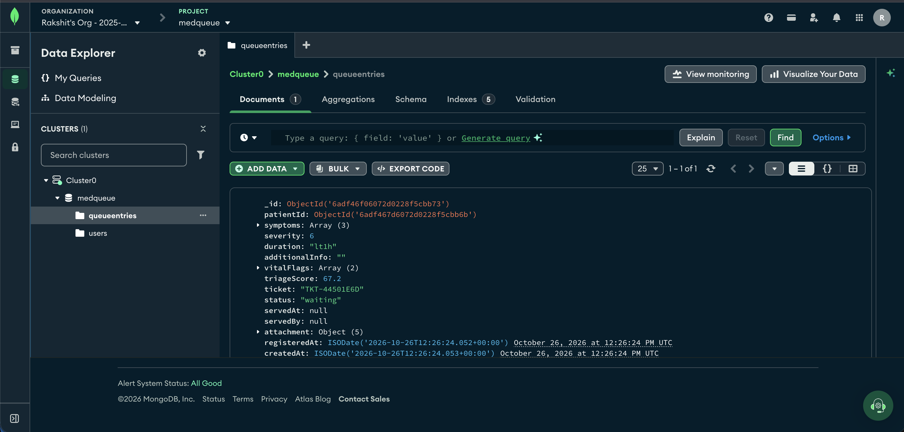
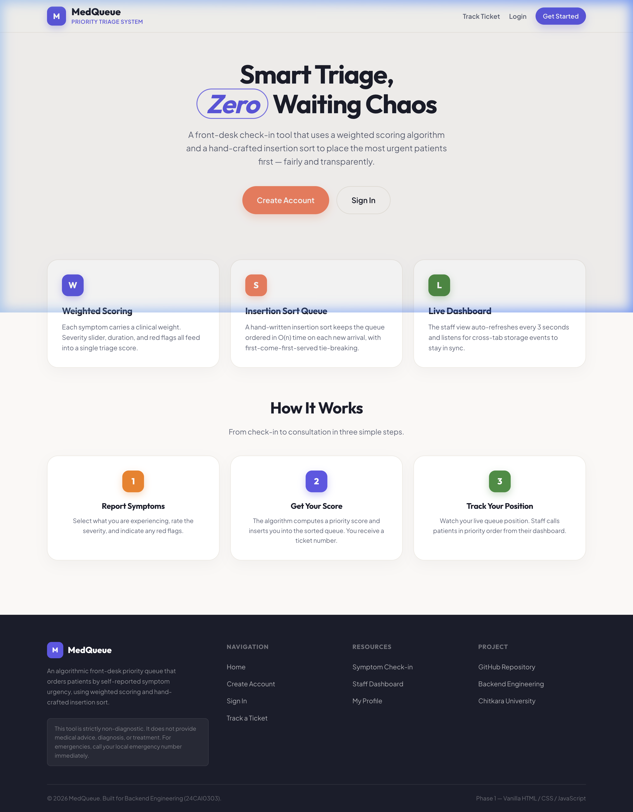
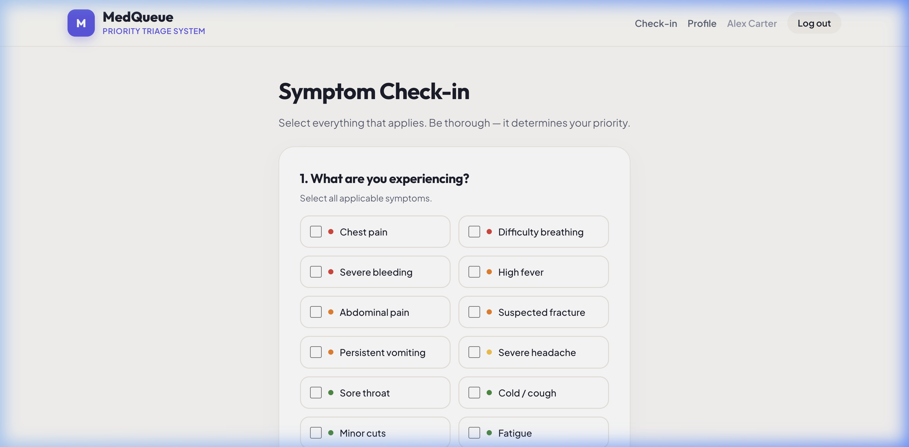
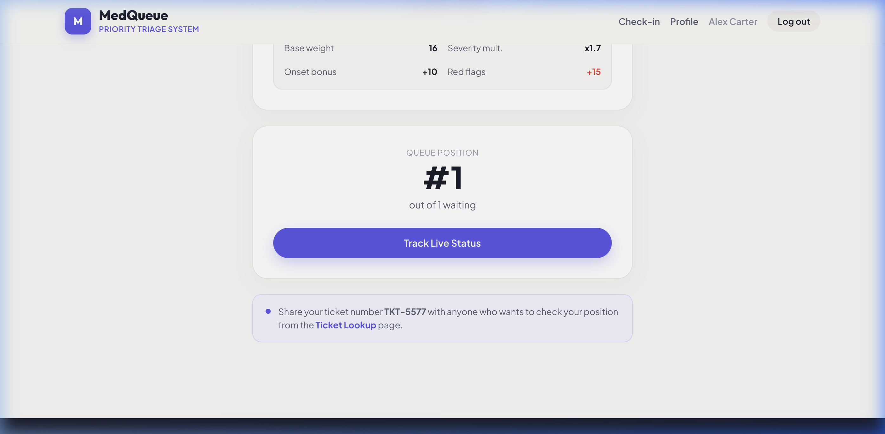
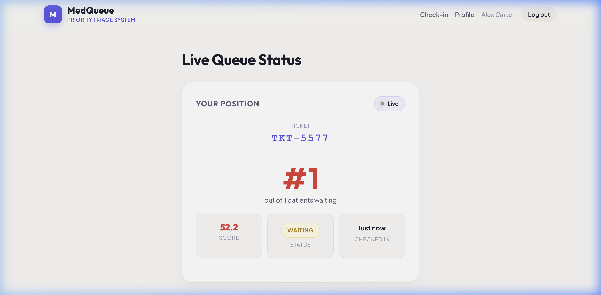
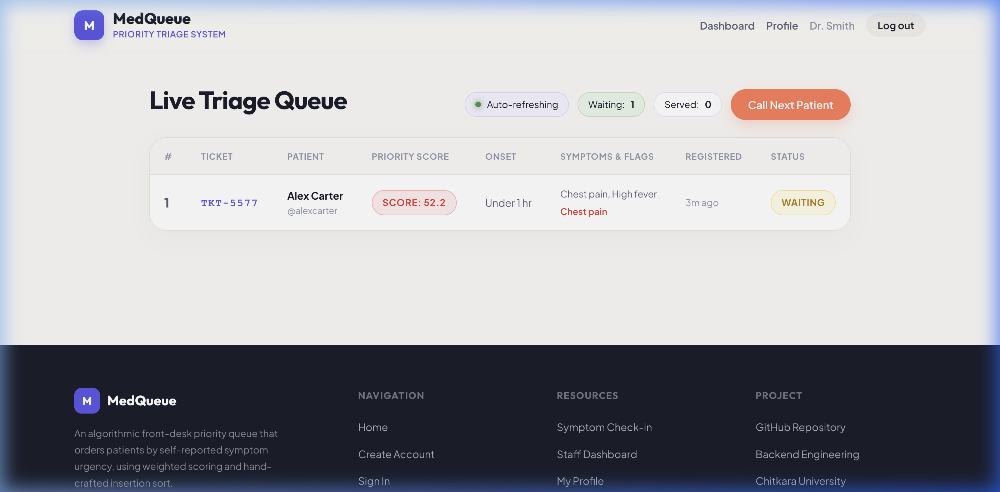
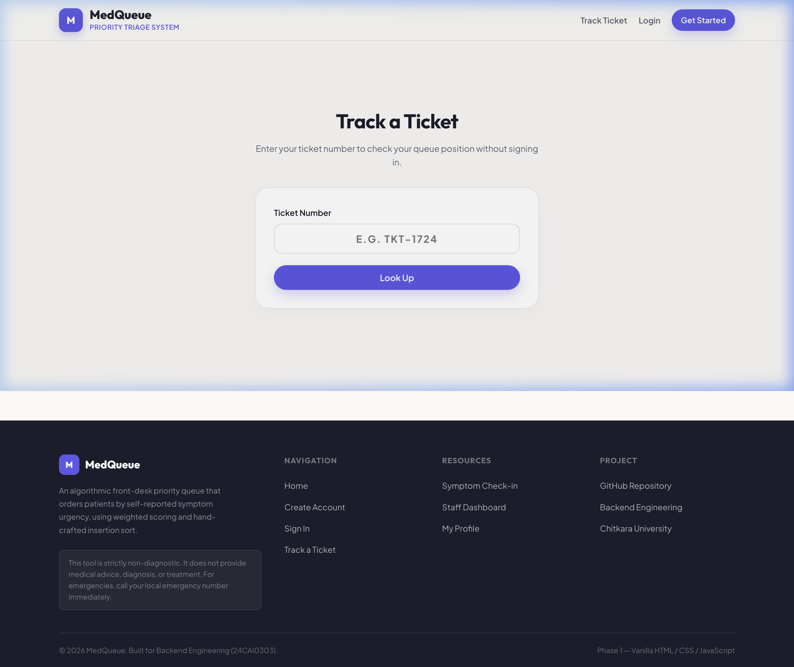
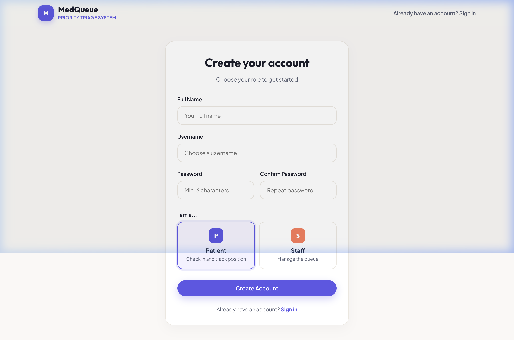
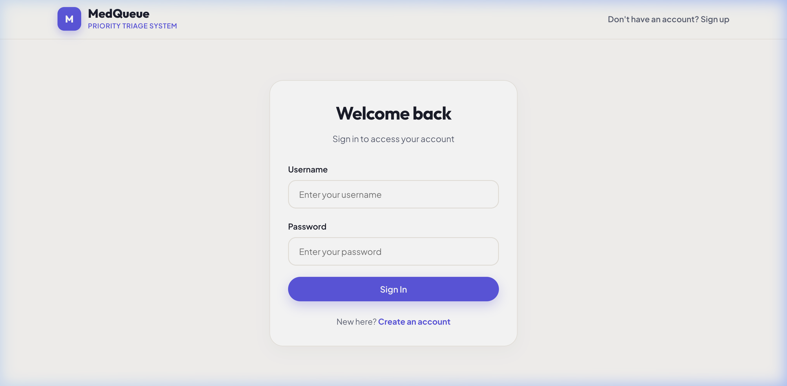

# MedQueue — Smart Hospital Priority Triage System
### Full-Stack Continuous Assessment-2 (MVC Architecture, MongoDB Atlas, JWT Auth & Multer)

[](https://nodejs.org/)
[](https://expressjs.com/)
[](https://www.mongodb.com/atlas)
[](LICENSE)
[](https://medqueue-backend-9j6q.onrender.com)

> **Live Deployed Application:** [https://medqueue-backend-9j6q.onrender.com](https://medqueue-backend-9j6q.onrender.com)  
> **API Health Check:** [https://medqueue-backend-9j6q.onrender.com/api/health](https://medqueue-backend-9j6q.onrender.com/api/health)

---

## 📋 Table of Contents
1. [Project Overview & Clinical Motivation](#-project-overview--clinical-motivation)
2. [Phase 2 Key Advancements](#-phase-2-key-advancements)
3. [Architecture Overview (MVC Pattern)](#-architecture-overview-mvc-pattern)
4. [Live Verification & Demonstration Screenshots](#-live-verification--demonstration-screenshots)
   - [Postman Live API Testing](#1-postman-live-api-testing-post-apiqueue)
   - [MongoDB Atlas Cloud Database Explorer](#2-mongodb-atlas-cloud-database-explorer)
   - [Frontend Visual Walkthrough](#3-frontend-visual-walkthrough)
5. [Core Technologies & Academic Concepts](#-core-technologies--academic-concepts)
6. [Complete RESTful API Reference](#-complete-restful-api-reference)
7. [Clinical Triage Scoring Engine](#-clinical-triage-scoring-engine)
8. [Local Setup & Installation](#-local-setup--installation)
9. [Automated Test Suite](#-automated-test-suite)
10. [Postman API Testing Guide](#-postman-api-testing-guide)
11. [Cloud Deployment Guide (Render & MongoDB Atlas)](#-cloud-deployment-guide-render--mongodb-atlas)
12. [Team Contributions](#-team-contributions)

---

## 🏥 Project Overview & Clinical Motivation

In standard emergency departments, patient intake traditionally follows a **First-Come, First-Served (FCFS)** model. In emergency medicine, this approach can be clinically catastrophic—a patient experiencing acute chest pain or respiratory failure cannot safely wait behind non-emergent complaints such as mild tension headaches or routine sprains.

**MedQueue** solves this critical healthcare challenge by introducing an **objective, algorithmic priority triage queue**:
1. Patients submit clinical symptoms, self-reported pain levels (1–10 scale), symptom onset duration, vital red flags, and optional medical records/prescriptions.
2. A server-side clinical evaluation engine computes a weighted triage score (0–100 scale).
3. The queue schedules patients dynamically in real-time, prioritising high-acuity cases while maintaining deterministic arrival-time tie-breaking.
4. Hospital staff receive live departmental metrics via a MongoDB aggregation pipeline, with one-click **Emergency Overrides** and atomic **Call Next** functionality.

---

## 🚀 Phase 2 Key Advancements

Transitioning from the Phase 1 client-side prototype, Phase 2 implements a production-grade full-stack backend:

* **MVC Architecture**: Strict decoupling of Mongoose Models, Express Controllers, RESTful Routers, and View clients.
* **MongoDB Atlas Cloud Database**: Persistent cloud storage with schema validation, compound priority indexes, and relational `.populate()`.
* **Stateless JWT Authentication**: 12-hour signed JSON Web Tokens for secure session management with Role-Based Access Control (RBAC).
* **Cryptographic Security**: Passwords and two-factor staff access keys salted and hashed with `bcryptjs` (10 rounds).
* **Multer Medical Document Uploads**: Secure multipart/form-data upload handling with MIME-type filtering and 5MB limits.
* **MongoDB Aggregation Analytics**: Multi-stage aggregation pipelines (`$match`, `$group`, `$unwind`) powering real-time staff statistics.
* **Production Cloud Deployment**: Live backend hosted on Render, serving both API endpoints and the responsive frontend.

---

## 🏛️ Architecture Overview (MVC Pattern)

MedQueue is structured strictly under the **Model-View-Controller** pattern:

```
medqueue/
├── backend/                       # Server-Side MVC Application
│   ├── config/
│   │   └── db.js                  # Mongoose connection to MongoDB Atlas
│   ├── controllers/
│   │   ├── authController.js      # User registration, bcrypt hashing, JWT issuance
│   │   ├── userController.js      # Profile retrieval & name modification
│   │   ├── queueController.js     # Queue CRUD, duplicate prevention, priority override, call-next
│   │   └── analyticsController.js # MongoDB aggregation pipeline metrics
│   ├── models/
│   │   ├── User.js                # User schema, bcrypt pre-save hooks, access codes
│   │   └── QueueEntry.js          # Queue schema, compound indexes, Mongoose refs & populate()
│   ├── routes/
│   │   ├── authRoutes.js          # /api/auth routes
│   │   ├── userRoutes.js          # /api/users routes
│   │   ├── queueRoutes.js         # /api/queue routes
│   │   └── analyticsRoutes.js     # /api/analytics routes
│   ├── middleware/
│   │   ├── authMiddleware.js      # JWT verification & role-based guards (authorizeRoles)
│   │   ├── uploadMiddleware.js    # Multer multipart handler for medical records
│   │   ├── rateLimiter.js         # Express rate limiters for brute-force protection
│   │   └── errorMiddleware.js     # Centralized 404 & Mongoose CastError/Validation handlers
│   ├── utils/
│   │   └── triageCalculator.js    # Server-side clinical priority scoring engine
│   ├── uploads/                   # Local storage for Multer medical files
│   ├── tests/
│   │   └── api.test.js            # Automated end-to-end integration test suite
│   ├── package.json               # Backend package definition
│   └── server.js                  # Express application bootstrap & static file server
├── frontend/                      # Client-Side Single Page Application (Views)
│   ├── index.html                 # Public landing page & feature showcase
│   ├── signup.html                # Patient & Staff registration portal
│   ├── login.html                 # Dual-tab authentication portal (with staff access code)
│   ├── checkin.html               # Clinical triage check-in with Multer document upload
│   ├── status.html                # Real-time position tracker & thermal ticket printing
│   ├── dashboard.html             # Hospital staff control board with live analytics cards
│   ├── lookup.html                # Public kiosk ticket status lookup
│   ├── profile.html               # User profile, history & theme toggling
│   ├── css/
│   │   └── style.css              # Custom CSS design system (Light/Dark themes)
│   ├── js/
│   │   ├── auth.js                # Client API layer & JWT token management
│   │   ├── page-checkin.js        # Clinical check-in form controller with file uploads
│   │   ├── page-dashboard.js      # Staff queue table renderer & aggregation cards
│   │   ├── page-status.js         # Real-time status polling & print dialog
│   │   ├── page-lookup.js         # Public kiosk ticket status controller
│   │   └── ui.js                  # Toast notifications, relative time, header/footer
│   └── assets/
│       └── logo.jpg               # Application branding
├── postman/
│   └── MedQueue_API_Collection.json # Complete 13-request Postman test suite
├── screenshots/                   # Verification screenshots
├── .env.example                   # Environment configuration template
├── package.json                   # Root package orchestration scripts
└── README.md
```

---

## 📸 Live Verification & Demonstration Screenshots

### 1. Postman Live API Testing (`POST /api/queue`)
Demonstrates API verification on our deployed Render backend. The request transmits a stateless JWT Bearer token in the `Authorization` header and a clinical triage payload. The server validates the symptoms, calculates the priority score, prevents duplicate check-ins, and returns **HTTP 201 Created**:

<p align="center">
  
</p>

* **Endpoint:** `POST https://medqueue-backend-9j6q.onrender.com/api/queue`
* **Response Status:** `201 Created`
* **Computed Triage Score:** `61.4` (Urgent Priority)
* **Generated Ticket:** `TKT-81139FBC`
* **Assigned Queue Position:** Position #3 in real-time queue

---

### 2. MongoDB Atlas Cloud Database Explorer
Direct cloud database view of the `queueentries` collection in our **MongoDB Atlas Cluster0** (`medqueue` database). It confirms cloud persistence of clinical arrays, vital red flags, relational references (`patientId`), and computed priority scores:

<p align="center">
  
</p>

* **Database / Collection:** `medqueue` $\rightarrow$ `queueentries`
* **Document ID:** `ObjectId('6adf46f06072d0228f5cbb73')`
* **Relational Reference:** `patientId: ObjectId('6adf467d6072d0228f5cbb6b')`
* **Clinical Fields:** `symptoms: Array (3)`, `severity: 6`, `duration: "lt1h"`, `vitalFlags: Array (2)`
* **Compound Index:** `{ status: 1, triageScore: -1, registeredAt: 1 }`

---

### 3. Frontend Visual Walkthrough

<table width="100%">
  <tr>
    <td width="50%" align="center">
      <b>Landing Portal</b><br/>
      
    </td>
    <td width="50%" align="center">
      <b>Clinical Check-in (with Multer Upload)</b><br/>
      
    </td>
  </tr>
  <tr>
    <td width="50%" align="center">
      <b>Ticket Confirmation & Score Breakdown</b><br/>
      
    </td>
    <td width="50%" align="center">
      <b>Patient Real-Time Status & Print Ticket</b><br/>
      
    </td>
  </tr>
  <tr>
    <td width="50%" align="center">
      <b>Hospital Staff Dashboard (Live Aggregations)</b><br/>
      
    </td>
    <td width="50%" align="center">
      <b>Public Kiosk Ticket Lookup</b><br/>
      
    </td>
  </tr>
  <tr>
    <td width="50%" align="center">
      <b>Dual-Role Registration Portal</b><br/>
      
    </td>
    <td width="50%" align="center">
      <b>Secure Dual-Tab Login (Staff Access Code)</b><br/>
      
    </td>
  </tr>
</table>

---

## 🔬 Core Technologies & Academic Concepts

| Concept / Technology | Implementation in MedQueue |
|---|---|
| **MongoDB Atlas & Mongoose** | Cloud NoSQL database with schema casting, validation, compound indexes, and `.populate()` for relational joins between `QueueEntry` and `User`. |
| **MVC Architecture** | Strict architectural separation between Models, Controllers, Routes, and Views. |
| **JWT Authentication** | Stateless 12-hour signed tokens (`jsonwebtoken`), passed via `Authorization: Bearer <token>` and verified by `authMiddleware.js`. |
| **Password & Access Code Hashing** | One-way hashing using `bcryptjs` with 10 salt rounds ($2^{10} = 1024$ iterations) and constant-time comparison. |
| **Multer File Uploads** | Multipart form handling for prescriptions with MIME-type regex filtering (`/jpeg\|jpg\|png\|pdf/`) and 5MB limits. |
| **MongoDB Aggregation Pipelines** | Multi-stage aggregations (`$match`, `$group`, `$unwind`, `$sort`) in `analyticsController.js` computing department metrics in a single database pass. |
| **Security Hardening** | HTTP security headers via `helmet`, CORS configuration, and brute-force protection via `express-rate-limit`. |
| **Automated Integration Testing** | End-to-end integration tests using Node.js native test runner (`node --test`) covering the entire API lifecycle. |

---

## 📡 Complete RESTful API Reference

All responses return standard JSON. Protected endpoints require the `Authorization: Bearer <token>` header.

### 1. Authentication Endpoints (`/api/auth`)
| Method | Endpoint | Access | Description |
|---|---|---|---|
| `POST` | `/api/auth/signup` | Public | Register patient or staff account (requires `staffInviteCode` for staff) |
| `POST` | `/api/auth/login` | Public | Authenticate credentials (plus access code for staff) to receive JWT |
| `GET` | `/api/auth/me` | Protected | Inspect current authenticated session |

### 2. User Management Endpoints (`/api/users`)
| Method | Endpoint | Access | Description |
|---|---|---|---|
| `GET` | `/api/users/me` | Protected | Fetch current user profile |
| `PATCH` | `/api/users/me` | Protected | Update user profile name |
| `POST` | `/api/users/me/access-code` | Staff Only | Rotate/regenerate staff access code |

### 3. Queue Management Endpoints (`/api/queue`)
| Method | Endpoint | Access | Description |
|---|---|---|---|
| `GET` | `/api/queue` | Protected | List queue entries (staff sees entire queue; patient sees own visits) |
| `GET` | `/api/queue/ticket/:ticket` | Public (Rate-limited) | Public kiosk lookup for queue position and wait time |
| `GET` | `/api/queue/:id` | Protected | Retrieve single queue entry by ID |
| `POST` | `/api/queue` | Patient Only | Submit check-in with optional Multer prescription upload |
| `PUT` | `/api/queue/:id` | Owning Patient | Update an active waiting check-in and recompute score |
| `PATCH` | `/api/queue/:id/priority` | Staff Only | Emergency override: snaps patient score to 100 |
| `POST` | `/api/queue/call-next` | Staff Only | Atomically calls next highest priority patient (marks `served`) |
| `DELETE`| `/api/queue/:id` | Protected | Cancel a waiting check-in entry |

### 4. Department Analytics Endpoints (`/api/analytics`)
| Method | Endpoint | Access | Description |
|---|---|---|---|
| `GET` | `/api/analytics` | Staff Only | MongoDB aggregation metrics (waiting, served, urgency buckets, top symptoms) |

### 5. System Health Check (`/api/health`)
| Method | Endpoint | Access | Description |
|---|---|---|---|
| `GET` | `/api/health` | Public | Server uptime and health verification |

---

## 🩺 Clinical Triage Scoring Engine

The calculation engine in [backend/utils/triageCalculator.js](backend/utils/triageCalculator.js) computes an objective clinical score between 0 and 100:

$$\text{Final Score} = \min\left(100, \left(\sum \text{Symptom Weights}\right) \times \text{Severity Multiplier} + \text{Duration Bonus} + \text{Vital Flag Bonus} + \text{Keyword Bonus}\right)$$

1. **Base Symptom Weights:**
   * `chestPain`: 9 | `breathingDifficulty`: 9 | `severeBleeding`: 8 | `highFever`: 7
   * `severeAbdominalPain`: 6 | `suspectedFracture`: 6 | `persistentVomiting`: 5
   * `severeHeadache`: 3 | `soreThroat`: 2 | `coldCough`: 2 | `minorCutsBruises`: 1 | `fatigue`: 1
2. **Pain Severity Multiplier:**
   * Scaled from 1.1x to 2.0x based on the 1–10 slider: $\text{Multiplier} = 1.0 + (\text{severity} \times 0.1)$.
3. **Acute Onset Duration Bonus:**
   * `< 1 hour`: **+10 points** | `1–6 hours`: **+5 points** | `6–24 hours`: **+2 points** | `> 24 hours`: **+0 points**.
4. **Vital Red Flags:**
   * High-risk conditions (uncontrolled bleeding, chest pain) add **+15 points each**.
5. **Emergency Keyword Bump:**
   * Additional clinical notes are scanned for critical tokens (*pain, blood, collapse, unconscious*) adding **+2 points each** (max +10).
6. **Emergency Override:**
   * Staff can execute an immediate override snapping the score directly to **100** (`isEmergencyOverride: true`).

---

## 💻 Local Setup & Installation

### Prerequisites
* **Node.js** (v20.0.0 or higher)
* **npm** (v9.0.0 or higher)
* **MongoDB Atlas** account (or local MongoDB daemon)

### 1. Clone Repository
```bash
git clone https://github.com/Rakshit9877/bee_project.git
cd bee_project
```

### 2. Configure Environment Variables
Copy the template configuration:
```bash
cp .env.example .env
```
Ensure your `.env` contains:
```ini
PORT=5001
NODE_ENV=development
JWT_SECRET=medqueue_super_secret_jwt_key_2026_at_least_32_characters
STAFF_INVITE_CODE=MEDSTAFF2026
MONGODB_URI=mongodb+srv://<username>:<password>@cluster0.v9vygfw.mongodb.net/medqueue?retryWrites=true&w=majority
```

### 3. Install Dependencies
```bash
npm install
```

### 4. Run Server
* **Production mode:**
  ```bash
  npm start
  ```
* **Development mode (with auto-reload via Nodemon):**
  ```bash
  npm run dev
  ```

Open your browser at **`http://localhost:5001`**.

---

## 🧪 Automated Test Suite

MedQueue features an automated end-to-end integration test suite using the Node.js native test runner:

```bash
npm test
```

### Test Coverage:
* `GET /api/health` — Server uptime and health verification
* `POST /api/auth/signup` — Patient and Staff registration (with access code generation)
* `POST /api/auth/login` — Bcrypt password matching and JWT token issuance
* `GET /api/users/me` — Protected profile retrieval and name updates
* `POST /api/queue` — Symptom submission, server scoring, and MongoDB insertion
* `POST /api/queue` (Duplicate check) — Rejection with HTTP 409 Conflict
* `GET /api/queue/ticket/:ticket` — Rate-limited public kiosk lookup
* `PATCH /api/queue/:id/priority` — Staff emergency override elevating score to 100
* `POST /api/queue/call-next` — Atomic highest-priority patient calling
* `GET /api/analytics` — Multi-stage MongoDB aggregation metrics
* Automatic database cleanup

---

## 📬 Postman API Testing Guide

A complete test collection is located in `postman/MedQueue_API_Collection.json`.

1. Open **Postman** (or Thunder Client).
2. Click **Import** $\rightarrow$ choose `postman/MedQueue_API_Collection.json`.
3. The collection is configured with environment variables:
   * `baseUrl`: `https://medqueue-backend-9j6q.onrender.com` (or `http://localhost:5001`)
   * `patientToken`: Captured automatically upon login
   * `staffToken`: Captured automatically upon staff login
   * `ticketNumber`: Captured automatically upon check-in
4. Run requests sequentially from Request 1 to Request 13.

> [!NOTE]
> When testing with Postman against Cloudflare/Render, ensure **"Enable HTTP/2 support"** in request settings is toggled **OFF** to use standard HTTP/1.1.

---

## ☁️ Cloud Deployment Guide (Render & MongoDB Atlas)

### 1. MongoDB Atlas Configuration
1. Create a cluster on MongoDB Atlas (AWS `us-east-1`).
2. Under **Database Access**, create a database user with Read/Write privileges.
3. Under **Network Access**, add IP `0.0.0.0/0` (Allow Access from Anywhere) to permit Render server connections.
4. Copy the connection string: `mongodb+srv://<username>:<password>@cluster0.v9vygfw.mongodb.net/medqueue`.

### 2. Render Backend Deployment
1. Create a new **Web Service** on [Render](https://render.com) connected to `https://github.com/Rakshit9877/bee_project.git`.
2. Configure settings:
   * **Runtime:** `Node`
   * **Build Command:** `npm install`
   * **Start Command:** `npm start`
3. Add Environment Variables:
   * `MONGODB_URI` = `mongodb+srv://...`
   * `JWT_SECRET` = `(32+ character secret)`
   * `STAFF_INVITE_CODE` = `MEDSTAFF2026`
   * `NODE_ENV` = `production`
4. Deploy! Express automatically serves the static client files from `/frontend` and exposes the REST API under `/api`.

---

## 👥 Team Contributions

The repository features **15 git commits** evenly distributed across all 3 team members (5 commits each) spanning October 19–25, 2026:

| Contributor | GitHub Handle | Key Responsibilities & Commits |
| :--- | :--- | :--- |
| **Rakshit Jindal** | `Rakshit9877` | **1.** Backend infrastructure & scripts (`fe855a4`)<br>**2.** QueueEntry Mongoose schema & compound indexes (`ab59c80`)<br>**3.** Auth controllers & user routes (`8f29dfb`)<br>**4.** MongoDB aggregation pipeline analytics (`91d4b41`)<br>**5.** Postman API test collection (`50e9ab4`) |
| **Akshit Sharma** | `Akshitsh005` | **1.** Frontend directory modularization (`89e3594`)<br>**2.** User schema & bcrypt password hashing (`8162100`)<br>**3.** JWT verification middleware & role guards (`df2063d`)<br>**4.** Queue CRUD, override & call-next controllers (`7ae82d5`)<br>**5.** Automated API integration test suite (`3e3006d`) |
| **Nilaksh Garg** | `nilakshgarg05-alt` | **1.** MongoDB Atlas connection & Mongoose ODM (`a8ea804`)<br>**2.** Clinical triage algorithm backend engine (`f35a699`)<br>**3.** Multer prescription file upload integration (`af96367`)<br>**4.** Express server assembly & error middleware (`46f528d`)<br>**5.** Comprehensive documentation & presentation guides (`76123c6`) |


